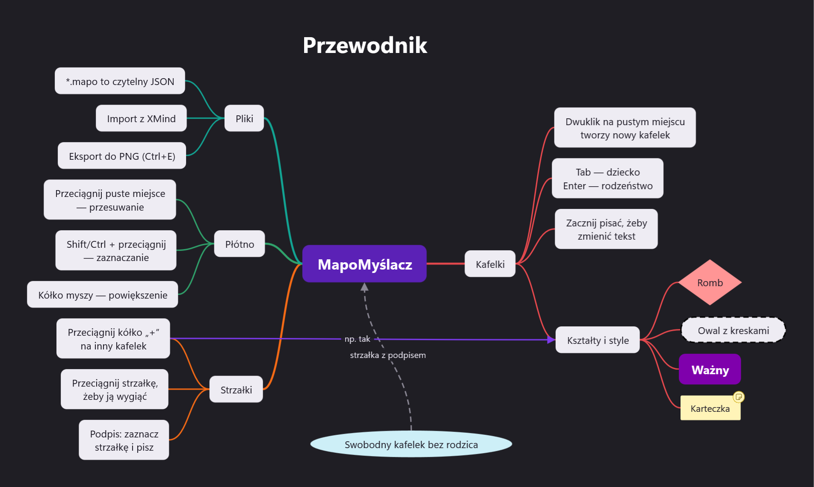

# MapoMyślacz

Program do map myśli: kafelki, gałęzie i strzałki z podpisami na nieskończonym płótnie. WinUI 3, skompilowany
do **Native AOT** (okno pojawia się w ułamku sekundy) i rozdawany jako **jeden plik `.exe`** — bez instalatora,
z automatycznymi aktualizacjami z wydań na GitHubie.

**Wersja 1.0** — co się zmieniało, opisuje [CHANGELOG.md](CHANGELOG.md), a pomysły na dalszy rozwój
[Developement.md](Developement.md).



## Co potrafi

- **Kafelki** z tekstem (wielowierszowym, z automatycznym zawijaniem): 7 kształtów — zaokrąglony, prostokąt,
  owal, elipsa, romb, sześciokąt i „sam tekst” (np. na tytuł mapy); wypełnienie, ramka (kolor, grubość,
  ciągła/kreski/kropki), czcionka (rozmiar, pogrubienie, kursywa, przekreślenie, wyrównanie), kolor tekstu
  dobierany automatycznie do tła. Kafelek może mieć **notatkę** (znaczek na kafelku, treść w panelu).
- **Gotowe style** jednym kliknięciem: Tytuł, Temat główny, Ważny, Ramka, Lokacja (romb), Cel (przerywany owal),
  Karteczka, Pomysł, Uwaga, Nieaktualne…
- **Gałęzie (drzewo)**: dziecko (Tab), rodzeństwo (Enter), kolorowe gałęzie z palety, zwijanie gałęzi (znaczek „+N”),
  **Uporządkuj** — automatyczny układ (temat główny rozkłada gałęzie na obie strony).
- **Strzałki** między dowolnymi kafelkami: podpis, kolor, grubość, linia ciągła/przerywana/kropkowana, groty na
  początku i/lub końcu, krzywa albo prosta. Wygina się je przeciągając samą strzałkę albo jej uchwyty.
- **Nieskończone płótno**: przesuwanie przeciąganiem pustego miejsca, powiększanie kółkiem (10–400%),
  „pokaż całą mapę”, zaznaczanie prostokątem z Shift/Ctrl.
- Cofnij/ponów (wszystko, także przeciąganie i zmiany stylu), kopiuj/wytnij/wklej/duplikuj — **wklejony tekst
  z wcięciami** (konspekt z Notatnika, lista z Worda, nagłówki Markdown) zamienia się w gałęzie, a skopiowane
  kafelki trafiają też do innych programów jako konspekt.
- **Pliki `.mapo`** (czytelny JSON), skojarzone z programem — dwuklik w Eksploratorze otwiera mapę; ostatnio
  otwierane, przeciąganie plików na okno, zapis „bezpieczny” (przez plik tymczasowy).
- **Import z XMind** (XMind 2020+/Zen): tematy, tematy swobodne z pozycjami, style, relacje z podpisami i krzywizną,
  notatki. **Eksport do PNG** (w dwukrotnej rozdzielczości).
- Jasny i ciemny motyw zgodnie z Windows (tło płótna może być też ustawione na stałe w mapie).

## Obsługa

| Mysz | Działanie |
|---|---|
| przeciągnij puste miejsce | przesuwanie płótna (też środkowy przycisk albo spacja + przeciągnięcie) |
| **Shift/Ctrl** + przeciągnij od pustego miejsca | zaznaczanie prostokątem (dokłada do zaznaczenia) |
| kółko myszy | powiększenie w miejscu kursora (Shift + kółko — przewijanie w poziomie) |
| klik / Ctrl+klik / Shift+klik | zaznacz / dodaj-odejmij / dodaj |
| przeciągnij kafelek | przesuwa go razem z gałęzią (Alt — bez gałęzi, Shift — tylko poziomo/pionowo) |
| dwuklik | na kafelku — edycja tekstu, na strzałce — podpis, na pustym miejscu — nowy kafelek |
| kółko **„+”** przy zaznaczonym kafelku | klik — dziecko; przeciągnij na kafelek — **strzałka**; na puste miejsce — dziecko tam |
| przeciągnij zaznaczoną strzałkę | wyginanie (albo białe uchwyty krzywizny) |
| prawy przycisk | menu z poleceniami |

| Klawisz | Działanie |
|---|---|
| Tab / Insert, Enter, Shift+Tab | dziecko, rodzeństwo, przejście do rodzica |
| F2 albo po prostu pisanie | edycja tekstu (Shift+Enter — nowy wiersz, Esc — anuluj, Tab — zatwierdź i dodaj dziecko) |
| strzałki / Ctrl+strzałki | przejście do sąsiedniego kafelka / przesunięcie o 10 px (z Shift o 1 px) |
| Delete | usuń (kafelek razem z gałęzią) |
| Ctrl+Z, Ctrl+Y | cofnij, ponów |
| Ctrl+C / X / V / D, Ctrl+A | kopiuj / wytnij / wklej / duplikuj, zaznacz wszystko |
| Ctrl+L | połącz strzałką (dwa zaznaczone kafelki albo wskaż drugi kliknięciem) |
| Ctrl+R, Ctrl+/ | uporządkuj gałęzie, zwiń/rozwiń |
| Ctrl+B, Ctrl+I | pogrubienie, kursywa |
| Ctrl+0, Ctrl+1, Ctrl+plus/minus | cała mapa, 100%, powiększenie |
| Ctrl+N / O / S / Shift+S / E, F1 | nowa / otwórz / zapisz / zapisz jako / eksport PNG, pomoc |

## Instalacja

Pobierz `MapoMyslacz.exe` ze strony [wydań](https://github.com/dkinvoker/MapoMyslacz/releases)
(komputery z procesorem ARM: `MapoMyslacz-arm64.exe`), połóż gdzie chcesz i uruchom. To wszystko.

Przy pierwszym uruchomieniu (trwa to sekundę–dwie) program:

1. rozpakowuje się do `%LOCALAPPDATA%\MapoMyslacz\app\<wersja>` — kolejne starty tej samej wersji są natychmiastowe,
   a stare wersje są automatycznie sprzątane,
2. kojarzy pliki `.mapo` ze sobą (tylko dla bieżącego użytkownika, bez uprawnień administratora) — dwuklik na mapie
   otwiera ją w MapoMyślaczu; po przeniesieniu exe skojarzenie aktualizuje się przy następnym starcie,
3. kładzie obok siebie **`MapoMyslacz - odinstaluj.cmd`**.

Ustawienia (ostatnie pliki, rozmiar okna, aktualizacje) i ewentualny dziennik błędów `crash.log` są w
`%LOCALAPPDATA%\MapoMyslacz`.

## Odinstalowanie

Dwuklik na **`MapoMyslacz - odinstaluj.cmd`**. Skrypt pokazuje, co usunie, i pyta o zgodę; potem usuwa skojarzenie
plików `.mapo`, folder `%LOCALAPPDATA%\MapoMyslacz`, sam program i na końcu siebie. **Twoje mapy zostają.**
Jeśli skrypt zniknął, uruchom program raz — pojawi się ponownie.

## Aktualizacje

Kilka sekund po starcie (najwyżej raz na dobę) program pyta GitHuba o najnowsze wydanie
(`api.github.com/repos/dkinvoker/MapoMyslacz/releases/latest` — bez żadnych danych o użytkowniku, tylko nazwa
i wersja programu w nagłówku). Gdy jest nowsza wersja, u góry okna pojawia się pasek: *Zaktualizuj*, *Co nowego?*
(opis wydania), *Pomiń tę wersję*. „Zaktualizuj” pobiera nowy exe, sprawdza jego **sumę SHA-256** podaną przez
GitHub (inna suma = przerwanie bez żadnych zmian), podmienia plik i po „Uruchom ponownie” startuje nowa wersja
z otwartą mapą. Automatyczne sprawdzanie można wyłączyć w menu **?**, tam też jest „Sprawdź aktualizacje”.

Wymagania: repozytorium z wydaniami musi być **publiczne** (API GitHuba bez logowania nie widzi prywatnych).
Nazwa repozytorium jest w `src/MapoMyslacz.Core/Updates/UpdateLogic.cs` (`Repository`).

### Wydawanie nowej wersji

1. Zmień numer w `Directory.Build.props` (`<Version>`), dopisz sekcję do `CHANGELOG.md` (np. `## 1.1 — 2026-12-01`).
2. Commit, a potem tag z tym samym numerem:
   ```bash
   git tag v1.1.0
   ```
   ```bash
   git push origin main --tags
   ```
3. Workflow [`.github/workflows/release.yml`](.github/workflows/release.yml) uruchomi testy, zbuduje
   `MapoMyslacz.exe` (x64) i `MapoMyslacz-arm64.exe`, wyciągnie opis zmian z CHANGELOG.md, dopisze sumy SHA-256
   i opublikuje wydanie. Zainstalowane kopie zobaczą je przy najbliższym sprawdzeniu.

Bez GitHub Actions: zbuduj `publish.ps1` i wgraj `dist\MapoMyslacz.exe` do nowego wydania ręcznie (tag `v1.1.0`).
GitHub sam liczy sumę SHA-256 plików wydania, więc aktualizacja z aplikacji też zadziała.

## Format pliku `.mapo`

Zwykły JSON (UTF-8), który da się czytać i poprawiać w Notatniku. Zapisywane są tylko wartości różne od domyślnych.

```json
{
  "format": "MapoMyslacz",
  "formatVersion": 1,
  "title": "Kampania",
  "background": "#FFFFFF",
  "view": { "x": 0, "y": 0, "zoom": 1 },
  "nodes": [
    { "id": "k1", "text": "Wioska", "style": { "shape": "none", "fontSize": 36, "bold": true } },
    { "id": "k2", "text": "Sołtys Emyr", "x": -49, "y": -165, "style": { "fill": "#7F00AC", "bold": true },
      "note": "Dłuższa notatka" },
    { "id": "k3", "text": "Mauzoleum", "x": -174, "y": -366, "parent": "k2", "collapsed": true,
      "style": { "shape": "diamond", "fill": "#FF9595" } }
  ],
  "links": [
    { "id": "s1", "from": "k2", "to": "k3", "label": "Potrzebny do ofiary",
      "c2": { "x": 68, "y": 42 }, "style": { "pattern": "solid", "arrowStart": true } }
  ]
}
```

- **Kafelek** (`nodes`): `x`, `y` to **środek** kafelka; `parent` — rodzic w drzewie (brak = temat główny lub kafelek
  swobodny); `width` — własna szerokość zawijania tekstu; `style`: `shape` (`rounded`, `rectangle`, `pill`, `ellipse`,
  `diamond`, `hexagon`, `none`), `fill`, `textColor`, `border`, `borderWidth`, `borderPattern` (`solid`, `dashed`,
  `dotted`), `fontSize`, `bold`, `italic`, `strike`, `align` (`center`, `left`, `right`), `branchColor`.
- **Strzałka** (`links`): `from` → `to`, `label`; `c1`/`c2` — punkty kontrolne krzywej **względem środków** kafelków
  początkowego/końcowego (dzięki temu kształt jedzie razem z kafelkami; brak = automatyczne „S”); `via` — punkty,
  przez które przechodzi gładka krzywa; `style`: `color`, `width`, `pattern`, `arrowStart`, `arrowEnd`,
  `curve` (`curved`, `straight`), `fontSize`.
- Kolory: `#RRGGBB` albo `#RRGGBBAA` (przezroczystość na końcu, jak w CSS).
- Przy odczycie program naprawia uszkodzenia (zdublowane id, nieistniejący rodzic, pętle w drzewie, strzałki do
  usuniętych kafelków), a komentarze `//` i przecinki na końcu list są dozwolone.

## Mapy z XMind

W programie: **Plik → Importuj z XMind…** (albo po prostu otwórz/przeciągnij plik `.xmind`) — mapa otwiera się jako
nowa, niezapisana; zapisz ją jako `.mapo`. Z linii poleceń, hurtowo (każdy arkusz to osobny plik):

```bash
dotnet run --project tools/XmindConvert -- "Plansza ogólna.xmind" "Plansza Sesji 1 - wioska.xmind"
```

Obsługiwany jest format XMind 2020+ (plik `content.json` w archiwum). Obrazki, ikony (markery), granice
i podsumowania nie są przenoszone — informacja o obrazku trafia do notatki kafelka.

## Budowanie ze źródeł

Wymagania: Windows 10/11, **.NET 10 SDK**, **Visual Studio (Build Tools) z „Programowaniem aplikacji klasycznych
w C++”** (linker dla Native AOT) i Windows SDK.

```bash
powershell -ExecutionPolicy Bypass -File publish.ps1
```

Wynik: `publish\win-x64\` (folder z aplikacją) i **`dist\MapoMyslacz.exe`** (jeden plik do rozdania).
Opcje: `-Arch arm64`, `-NoSingleFile`, `-Version 1.2.0`.

Do pracy nad kodem wystarczy zwykłe `dotnet build` / uruchomienie projektu `src/MapoMyslacz` (wersja Debug działa
z folderu `bin` i nie zmienia skojarzeń plików w systemie).

### Jak powstaje jeden plik

Aplikacja WinUI 3 w trybie *self-contained* to exe i ~200 plików Windows App SDK (biblioteki, zasoby `.pri`).
`publish.ps1` publikuje ją do folderu, a potem buduje **starter** (`src/MapoMyslacz.Launcher`, też Native AOT,
bez WinUI), który dostaje ten folder spakowany jako zasób. Starter przy pierwszym uruchomieniu rozpakowuje go do
`%LOCALAPPDATA%` (do folderu tymczasowego, a potem jednym przeniesieniem — przerwane rozpakowanie nie zostawia
„półaplikacji”), uruchamia właściwy program z przekazaniem argumentów i swojej ścieżki
(zmienna `MAPOMYSLACZ_LAUNCHER`), po czym się kończy.

### Tryb wiersza poleceń

```bash
MapoMyslacz.exe mapa.mapo --export-png obraz.png --scale 2
```

Działa też z plikiem `.xmind`. Kod wyjścia 0 = sukces (szczegóły błędu w `crash.log`).

## Struktura projektu

| Folder | Zawartość |
|---|---|
| `src/MapoMyslacz` | aplikacja WinUI 3: okno, panel właściwości, płótno (`Editor/MapCanvas*.cs`), aktualizacje, skojarzenia |
| `src/MapoMyslacz.Core` | logika bez interfejsu: model i format `.mapo`, operacje, historia cofania, geometria strzałek, układ, style, import XMind, logika aktualizacji |
| `src/MapoMyslacz.Launcher` | jednoplikowy starter: rozpakowanie, uruchomienie, skrypt odinstalowania |
| `src/MapoMyslacz.Tests` | testy jednostkowe (xUnit) |
| `tools/` | `XmindConvert` (konwersja z XMind), `make-icon.ps1` (ikona), `make-cursors.ps1` (kursory „łapek”) |
| `samples/` | przykładowa mapa `Przewodnik.mapo` |

## Testy

```bash
dotnet test src/MapoMyslacz.Tests
```

Ponad 90 testów: format pliku i naprawa uszkodzonych map, operacje edycyjne i schowek, historia cofania, geometria
(krawędzie kształtów, krzywe, wyginanie strzałek), automatyczny układ, style i kolory, import XMind i konspektu,
logika aktualizacji, rozpakowywanie startera i skrypt odinstalowania. Testy nie otwierają okna.

Diagnostyka: zmienna środowiskowa `MAPOMYSLACZ_TRACE=<plik>` zapisuje zdarzenia myszy i edycji płótna,
`MAPOMYSLACZ_UPDATE_FEED=<adres>` podmienia adres sprawdzania aktualizacji (np. na lokalny serwer testowy).
