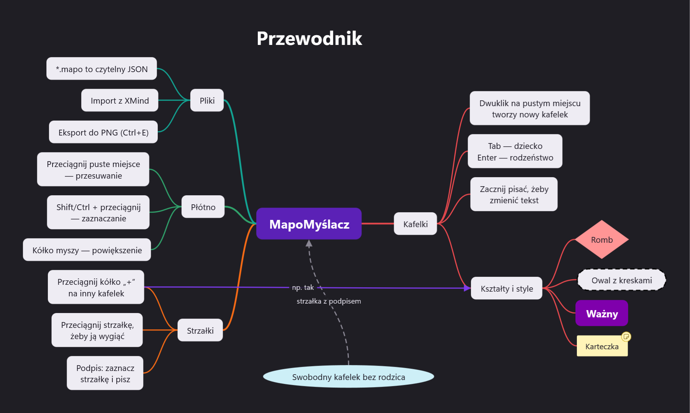

# MapoMyślacz

Program do map myśli: kafelki, gałęzie i strzałki z podpisami na nieskończonym płótnie. WinUI 3, skompilowany
do **Native AOT** (okno pojawia się w ułamku sekundy) i rozdawany jako **jeden plik `.exe`** — bez instalatora,
z automatycznymi aktualizacjami z wydań na GitHubie.

**Wersja 1.4** — co się zmieniało, opisuje [CHANGELOG.md](CHANGELOG.md), a pomysły na dalszy rozwój
[Developement.md](Developement.md).



## Co potrafi

- **Kafelki** z tekstem (wielowierszowym, z automatycznym zawijaniem): 7 kształtów — zaokrąglony, prostokąt,
  owal, elipsa, romb, sześciokąt i „sam tekst” (np. na tytuł mapy); wypełnienie, ramka (kolor, grubość,
  ciągła/kreski/kropki), czcionka (rozmiar, pogrubienie, kursywa, przekreślenie, wyrównanie), kolor tekstu
  dobierany automatycznie do tła. Kafelek może mieć **notatkę** (znaczek na kafelku, treść w panelu)
  i **obrazek** nad tekstem — wklejony (Ctrl+V), przeciągnięty z Eksploratora albo wybrany w panelu, z uchwytem
  do zmiany rozmiaru; obrazki są osadzone w pliku mapy, więc mapa zostaje jednym plikiem.
- **Gotowe style** jednym kliknięciem: Tytuł, Temat główny, Ważny, Ramka, Lokacja (romb), Cel (przerywany owal),
  Karteczka, Pomysł, Uwaga, Nieaktualne…
- **Gałęzie (drzewo)**: dziecko (Tab), rodzeństwo (Enter), kolorowe gałęzie z palety, zwijanie gałęzi (znaczek „+N”),
  **Uporządkuj** — automatyczny układ (temat główny rozkłada gałęzie na obie strony). Gałąź (linia od rodzica)
  da się kliknąć: Delete odpina kafelek od rodzica, menu ma „Zamień na strzałkę” i kolor gałęzi. W **Opcjach**
  (menu „?” albo Ctrl+,) nowe kafelki z Tab, Enter i kółka „+” mogą się łączyć **strzałką** zamiast gałęzią.
- **Strzałki** między dowolnymi kafelkami: podpis, kolor, grubość, linia ciągła/przerywana/kropkowana, groty na
  początku i/lub końcu, łuk, prosta albo **łamana** pod kątem prostym (jak w drzewie genealogicznym). Wygina się je
  przeciągając samą strzałkę albo jej uchwyty.
- **Znaczniki**: priorytet 1–5, postęp 0–100%, symbole (✅ ⚠️ ❓ ⭐ 🗡️ 🏰 🐉 …) i dowolne emoji przed tekstem kafelka.
- **Linki w kafelkach**: strona internetowa albo plik — także **inna mapa** (ścieżka względna, więc mapy łączą się
  w „kampanię”) albo **konkretny kafelek** w tej lub innej mapie. Ctrl+klik albo klik w niebieski znaczek otwiera
  link, Alt+← wraca do poprzedniej mapy. Panel mapy pokazuje **linki zwrotne** — mapy z folderu, które prowadzą do tej.
- **Arkusze**: kilka map w jednym pliku, z zakładkami pod płótnem (np. osobny arkusz na każdą sesję gry) — dodawanie
  (Ctrl+T), zmiana nazwy, kopia, przestawianie, przełączanie Ctrl+PageUp/PageDown. Kafelki przeciągnięte na zakładkę
  przechodzą na tamten arkusz; wyszukiwanie, zamiana, PDF i konspekt obejmują wszystkie arkusze naraz.
- **Motywy map**: Domyślny, Pastelowy, Noc, Pergamin, Tablica, Schemat, Wysoki kontrast — kolory płótna, kafelków,
  tematu głównego i palety gałęzi jednym kliknięciem; osobno **styl strzałek** (przerywane, ciągłe, kropki, proste,
  łamane, w kolorze gałęzi, dwustronne) i **kształt gałęzi** — łuki, proste albo łamane pod kątem prostym (drzewa
  genealogiczne, schematy organizacyjne). Motyw uzupełnia tylko to, czego kafelek nie ustawia sam.
- **Nieskończone płótno** rysowane przez **Win2D** (szybkie także przy tysiącach kafelków): przesuwanie
  przeciąganiem pustego miejsca, powiększanie kółkiem (5–400%), „pokaż całą mapę”, zaznaczanie prostokątem z Shift/Ctrl.
- **Druk i PDF** z podglądem: cała mapa dopasowana do kartki A4 (A3, A5, Letter) albo podział na strony w skali
  (plakat), orientacja, marginesy, tytuł na górze, białe tło, 150–600 dpi.
- Cofnij/ponów (wszystko, także przeciąganie i zmiany stylu), kopiuj/wytnij/wklej/duplikuj — **wklejony tekst
  z wcięciami** (konspekt z Notatnika, lista z Worda, nagłówki Markdown) zamienia się w gałęzie, a skopiowane
  kafelki trafiają też do innych programów jako konspekt.
- **Pliki `.mapo`** (czytelny JSON), skojarzone z programem — dwuklik w Eksploratorze otwiera mapę; ostatnio
  otwierane, przeciąganie plików na okno, zapis „bezpieczny” (przez plik tymczasowy).
- **Import z XMind** (XMind 2020+/Zen): tematy, tematy swobodne z pozycjami, style, relacje z podpisami i krzywizną,
  notatki, obrazki, granice (jako ramki), wszystkie arkusze (jako zakładki). **Eksport do PNG** (w dwukrotnej
  rozdzielczości). **Konspekt Markdown** — eksport i import (.md, .txt) z notatkami, linkami, znacznikami, strzałkami,
  ramkami i arkuszami.
- **Ramki** wokół grup kafelków (Ctrl+G; kafelek upuszczony w ramce do niej dołącza), wyrównywanie i rozkładanie
  zaznaczonych, linie pomocnicze i przyciąganie do siatki przy przeciąganiu, **wyszukiwanie i zamiana** (Ctrl+F,
  Ctrl+H — bez wielkości liter i polskich znaków), **fokus na gałęzi** (Ctrl+Shift+F), **minimapa**, siatka kropek.
- **Własne gotowe style** (Styl → „Zapisz styl zaznaczonego kafelka jako mój”) — dostępne we wszystkich mapach.
- **Autozapis** (co 1–10 minut) i odzyskiwanie niezapisanej mapy po awarii; **historia wersji** — przy każdym zapisie
  poprzednia wersja trafia do historii (Plik → Historia wersji…), skąd można wrócić do mapy „z wczoraj”.
- Jasny i ciemny wygląd okna zgodnie z Windows (tło płótna wynika z motywu mapy albo jest ustawione na stałe).

## Obsługa

| Mysz | Działanie |
|---|---|
| przeciągnij puste miejsce | przesuwanie płótna (też środkowy przycisk albo spacja + przeciągnięcie) |
| **Shift/Ctrl** + przeciągnij od pustego miejsca | zaznaczanie prostokątem (dokłada do zaznaczenia) |
| kółko myszy | powiększenie w miejscu kursora (Shift + kółko — przewijanie w poziomie) |
| klik / Ctrl+klik / Shift+klik | zaznacz / dodaj-odejmij / dodaj |
| przeciągnij kafelek | przesuwa go razem z gałęzią (Alt — bez gałęzi, Shift — tylko poziomo/pionowo, Ctrl — bez przyciągania) |
| kwadracik w rogu zaznaczonego kafelka | szerokość tekstu albo rozmiar obrazka (dwuklik — automatyczna) |
| klik w gałąź (linię od rodzica) | zaznacza ją: Delete odpina kafelek, prawy przycisk — „Zamień na strzałkę”, kolor |
| przeciągnij plik obrazka na okno | na kafelek — obrazek w nim, na puste miejsce — nowy kafelek z obrazkiem |
| zakładka arkusza (pod płótnem) | klik — przełącza, dwuklik/prawy przycisk — nazwa, kopia, przestawianie, usuwanie; „+” — nowy |
| nagłówek ramki | przeciągnij — przesuwa całą grupę, dwuklik — nazwa |
| kafelek upuszczony w ramce / na zakładce arkusza | dołącza do ramki / przechodzi na tamten arkusz (z gałęzią) |
| minimapa (prawy dolny róg) | klik / przeciągnięcie — przejście w to miejsce mapy |
| dwuklik | na kafelku — edycja tekstu, na strzałce — podpis, na pustym miejscu — nowy kafelek |
| kółko **„+”** przy zaznaczonym kafelku | klik — dziecko; przeciągnij na kafelek — **strzałka**; na puste miejsce — dziecko tam |
| przeciągnij zaznaczoną strzałkę | wyginanie (albo białe uchwyty krzywizny) |
| Ctrl+klik na kafelku z linkiem, klik w niebieski znaczek | otwiera link (strona, plik, inna mapa) |
| prawy przycisk | menu z poleceniami (także znaczniki i „Otwórz link”) |

| Klawisz | Działanie |
|---|---|
| Tab / Insert, Enter, Shift+Tab | dziecko, rodzeństwo, przejście do rodzica (dziecko/rodzeństwo ze strzałką — Opcje) |
| F2 albo po prostu pisanie | edycja tekstu (Shift+Enter — nowy wiersz, Esc — anuluj, Tab — zatwierdź i dodaj dziecko) |
| strzałki / Ctrl+strzałki | przejście do sąsiedniego kafelka / przesunięcie o 10 px (z Shift o 1 px) |
| Delete | usuń (kafelek razem z gałęzią) |
| Ctrl+Z, Ctrl+Y | cofnij, ponów |
| Ctrl+C / X / V / D, Ctrl+A | kopiuj / wytnij / wklej (też obrazek ze schowka) / duplikuj, zaznacz wszystko |
| Ctrl+L | połącz strzałką (dwa zaznaczone kafelki albo wskaż drugi kliknięciem) |
| Ctrl+G | otocz zaznaczone kafelki ramką |
| Ctrl+F, F3 / Shift+F3, Ctrl+H | szukaj, następny / poprzedni wynik, zamień (Enter — w bieżącym, Ctrl+Enter — wszędzie) |
| Ctrl+Shift+F, Esc | pokaż tylko zaznaczoną gałąź i jej powiązania, wróć do całej mapy |
| Ctrl+R, Ctrl+/ | uporządkuj gałęzie, zwiń/rozwiń |
| Ctrl+B, Ctrl+I | pogrubienie, kursywa |
| Ctrl+0, Ctrl+1, Ctrl+plus/minus | cała mapa, 100%, powiększenie |
| Ctrl+N / O / S / Shift+S | nowa / otwórz / zapisz / zapisz jako |
| Ctrl+P, Ctrl+Shift+E, Ctrl+E | drukuj, PDF, obraz PNG |
| Ctrl+T, Ctrl+PageDown / PageUp | nowy arkusz, następny / poprzedni arkusz |
| Ctrl+, | opcje (także menu „?” → Opcje…) |
| Alt+←, F1 | powrót do poprzedniej mapy (po przejściu linkiem), pomoc |

## Instalacja

Pobierz `MapoMyslacz.exe` ze strony [wydań](https://github.com/dkinvoker/MapoMyslacz/releases)
(komputery z procesorem ARM: `MapoMyslacz-arm64.exe`), połóż gdzie chcesz i uruchom. To wszystko.

Przy pierwszym uruchomieniu (trwa to sekundę–dwie) program:

1. rozpakowuje się do `%LOCALAPPDATA%\MapoMyslacz\app\<wersja>` — kolejne starty tej samej wersji są natychmiastowe,
   a stare wersje są automatycznie sprzątane,
2. kojarzy pliki `.mapo` ze sobą (tylko dla bieżącego użytkownika, bez uprawnień administratora) — dwuklik na mapie
   otwiera ją w MapoMyślaczu; po przeniesieniu exe skojarzenie aktualizuje się przy następnym starcie,
3. kładzie obok siebie **`MapoMyslacz - odinstaluj.cmd`**.

Ustawienia (ostatnie pliki, rozmiar okna, aktualizacje) i ewentualny dziennik błędów `crash.log` są w
`%LOCALAPPDATA%\MapoMyslacz`.

## Odinstalowanie

Dwuklik na **`MapoMyslacz - odinstaluj.cmd`**. Skrypt pokazuje, co usunie, i pyta o zgodę; potem usuwa skojarzenie
plików `.mapo`, folder `%LOCALAPPDATA%\MapoMyslacz`, sam program i na końcu siebie. **Twoje mapy zostają.**
Jeśli skrypt zniknął, uruchom program raz — pojawi się ponownie.

## Aktualizacje

Kilka sekund po starcie (najwyżej raz na dobę) program pyta GitHuba o najnowsze wydanie
(`api.github.com/repos/dkinvoker/MapoMyslacz/releases/latest` — bez żadnych danych o użytkowniku, tylko nazwa
i wersja programu w nagłówku). Gdy jest nowsza wersja, u góry okna pojawia się pasek: *Zaktualizuj*, *Co nowego?*
(opis wydania), *Pomiń tę wersję*. „Zaktualizuj” pobiera nowy exe, sprawdza jego **sumę SHA-256** podaną przez
GitHub (inna suma = przerwanie bez żadnych zmian), podmienia plik i po „Uruchom ponownie” startuje nowa wersja
z otwartą mapą. Automatyczne sprawdzanie można wyłączyć w menu **?**, tam też jest „Sprawdź aktualizacje”.

Wymagania: repozytorium z wydaniami musi być **publiczne** (API GitHuba bez logowania nie widzi prywatnych).
Nazwa repozytorium jest w `src/MapoMyslacz.Core/Updates/UpdateLogic.cs` (`Repository`). **Nie zmieniaj jej** —
zainstalowane wersje szukają wydań pod `dkinvoker/MapoMyslacz`; dawna nazwa `MapoMy-lacz` jest tylko zapasowa.

### Wydawanie nowej wersji

1. Zmień numer w `Directory.Build.props` (`<Version>`), dopisz sekcję do `CHANGELOG.md` (np. `## 1.1 — 2026-12-01`).
2. **Najpierw commit**, dopiero potem tag z tym samym numerem (tag dostaje commit, który jest *w tej chwili*
   wybrany — tag zrobiony przed commitem zbuduje wydanie ze starego kodu):
   ```bash
   git add -A
   ```
   ```bash
   git commit -m "1.1.0"
   ```
   (`git commit -am` sam w sobie pomija **nowe** pliki — wydanie zbudowałoby się bez nich albo wcale.)
   ```bash
   git tag v1.1.0
   ```
   ```bash
   git push origin main --tags
   ```
   Opublikowanego numeru wersji nie używaj drugi raz — jeśli wydanie wyszło źle, usuń je i wydaj kolejny numer
   (zainstalowane programy, które już pobrały zepsute wydanie, nie zobaczyłyby poprawki z tym samym numerem).
3. Workflow [`.github/workflows/release.yml`](.github/workflows/release.yml) uruchomi testy, zbuduje
   `MapoMyslacz.exe` (x64) i `MapoMyslacz-arm64.exe`, wyciągnie opis zmian z CHANGELOG.md, dopisze sumy SHA-256
   i opublikuje wydanie. Zainstalowane kopie zobaczą je przy najbliższym sprawdzeniu.

Bez GitHub Actions: zbuduj `publish.ps1` i wgraj `dist\MapoMyslacz.exe` do nowego wydania ręcznie (tag `v1.1.0`).
GitHub sam liczy sumę SHA-256 plików wydania, więc aktualizacja z aplikacji też zadziała.

## Format pliku `.mapo`

Zwykły JSON (UTF-8), który da się czytać i poprawiać w Notatniku. Zapisywane są tylko wartości różne od domyślnych.

```json
{
  "format": "MapoMyslacz",
  "formatVersion": 1,
  "title": "Kampania",
  "background": "#FFFFFF",
  "view": { "x": 0, "y": 0, "zoom": 1 },
  "nodes": [
    { "id": "k1", "text": "Wioska", "style": { "shape": "none", "fontSize": 36, "bold": true } },
    { "id": "k2", "text": "Sołtys Emyr", "x": -49, "y": -165, "style": { "fill": "#7F00AC", "bold": true },
      "note": "Dłuższa notatka" },
    { "id": "k3", "text": "Mauzoleum", "x": -174, "y": -366, "parent": "k2", "collapsed": true,
      "style": { "shape": "diamond", "fill": "#FF9595" } }
  ],
  "links": [
    { "id": "s1", "from": "k2", "to": "k3", "label": "Potrzebny do ofiary",
      "c2": { "x": 68, "y": 42 }, "style": { "pattern": "solid", "arrowStart": true } }
  ],
  "frames": [
    { "id": "r1", "title": "Wioska", "nodes": ["k2"], "color": "#30A46C" }
  ]
}
```

- **Kafelek** (`nodes`): `x`, `y` to **środek** kafelka; `parent` — rodzic w drzewie (brak = temat główny lub kafelek
  swobodny); `width` — własna szerokość zawijania tekstu; `style`: `shape` (`rounded`, `rectangle`, `pill`, `ellipse`,
  `diamond`, `hexagon`, `none`), `fill`, `textColor`, `border`, `borderWidth`, `borderPattern` (`solid`, `dashed`,
  `dotted`), `fontSize`, `bold`, `italic`, `strike`, `align` (`center`, `left`, `right`), `branchColor`;
  `icons` — znaczniki (`"priority-1"`…`"priority-5"`, `"progress-0"`…`"progress-100"` albo dowolne emoji, np. `"🏰"`);
  `link` — adres, ścieżka do pliku (względna wobec mapy, np. `"Sesje/sesja 2.mapo"`) albo kafelek: `"#k3"`
  w tej mapie, `"Sesje/sesja 2.mapo#k7"` w innej.
- **Strzałka** (`links`): `from` → `to`, `label`; `c1`/`c2` — punkty kontrolne krzywej **względem środków** kafelków
  początkowego/końcowego (dzięki temu kształt jedzie razem z kafelkami; brak = automatyczne „S”); `via` — punkty,
  przez które przechodzi gładka krzywa; `style`: `color`, `width`, `pattern`, `arrowStart`, `arrowEnd`,
  `curve` (`curved`, `straight`, `elbow` — łamana; wtedy `c1` przesuwa jej środkowy odcinek), `fontSize`.
- **Ramka** (`frames`, opcjonalne): `title`, `nodes` — kafelki w ramce (ich gałęzie należą do niej automatycznie),
  `color`. Ramka nie ma własnej pozycji — zawsze obejmuje swoje kafelki. Starsze wersje programu ramki pomijają.
- **Motyw** (opcjonalne): `theme` — `domyslny`, `pastel`, `noc`, `pergamin`, `tablica`, `schemat`, `kontrast`;
  `arrowStyle` — styl strzałek niezależny od motywu: `przerywane`, `ciagle`, `kropki`, `proste`, `lamane`,
  `kolorowe` (w kolorze gałęzi kafelka początkowego), `dwustronne`. Motyw podaje wartości domyślne — to, co jest
  zapisane w `style` kafelka albo strzałki, zawsze wygrywa. `branchCurve` — kształt gałęzi drzewa (`curved`,
  `straight`, `elbow`; brak — z motywu).
- **Obrazki** (opcjonalne): `images` — słownik `"img-…": "data:image/png;base64,…"` (PNG albo JPEG, osadzone w pliku);
  kafelek odwołuje się do obrazka polem `"image": { "id": "img-…", "width": 240, "height": 160 }` (rozmiar na mapie).
  Ten sam obrazek w kilku kafelkach zapisuje się raz. Starsze wersje programu pokazują sam tekst.
- **Arkusze** (opcjonalne): pierwszy arkusz to sama mapa (więc starsze wersje programu otwierają go jak zwykle),
  kolejne leżą w `sheets` — każdy jak mapa (`title`, `view`, `nodes`, `links`, `frames`, `theme`…), bez `format`
  i bez własnych `images` (obrazki są wspólne, w korzeniu pliku).
- Kolory: `#RRGGBB` albo `#RRGGBBAA` (przezroczystość na końcu, jak w CSS).
- Przy odczycie program naprawia uszkodzenia (zdublowane id, nieistniejący rodzic, pętle w drzewie, strzałki do
  usuniętych kafelków), a komentarze `//` i przecinki na końcu list są dozwolone.

## Mapy z XMind

W programie: **Plik → Importuj → Z XMind…** (albo po prostu otwórz/przeciągnij plik `.xmind`) — mapa otwiera się jako
nowa, niezapisana (każdy arkusz XMind jako osobna zakładka); zapisz ją jako `.mapo`. Z linii poleceń, hurtowo
(każdy arkusz to osobny plik):

```bash
dotnet run --project tools/XmindConvert -- "Plansza ogólna.xmind" "Plansza Sesji 1 - wioska.xmind"
```

Obsługiwany jest format XMind 2020+ (plik `content.json` w archiwum). Przenoszone są też znaczniki (priorytety,
postęp, flagi, gwiazdki), linki, obrazki (osadzone w mapie), granice (jako ramki) i relacje łamane. Podsumowania nie
są przenoszone.

## Budowanie ze źródeł

Wymagania: Windows 10/11, **.NET 10 SDK**, **Visual Studio (Build Tools) z „Programowaniem aplikacji klasycznych
w C++”** (linker dla Native AOT) i Windows SDK.

```bash
powershell -ExecutionPolicy Bypass -File publish.ps1
```

Wynik: `publish\win-x64\` (folder z aplikacją) i **`dist\MapoMyslacz.exe`** (jeden plik do rozdania).
Opcje: `-Arch arm64`, `-NoSingleFile`, `-Version 1.3.0`.

Do pracy nad kodem wystarczy zwykłe `dotnet build` / uruchomienie projektu `src/MapoMyslacz` (wersja Debug działa
z folderu `bin` i nie zmienia skojarzeń plików w systemie).

### Jak powstaje jeden plik

Aplikacja WinUI 3 w trybie *self-contained* to exe i ~200 plików Windows App SDK (biblioteki, zasoby `.pri`).
`publish.ps1` publikuje ją do folderu, a potem buduje **starter** (`src/MapoMyslacz.Launcher`, też Native AOT,
bez WinUI), który dostaje ten folder spakowany jako zasób. Starter przy pierwszym uruchomieniu rozpakowuje go do
`%LOCALAPPDATA%` (do folderu tymczasowego, a potem jednym przeniesieniem — przerwane rozpakowanie nie zostawia
„półaplikacji”), uruchamia właściwy program z przekazaniem argumentów i swojej ścieżki
(zmienna `MAPOMYSLACZ_LAUNCHER`), po czym się kończy.

### Tryb wiersza poleceń

```bash
MapoMyslacz.exe mapa.mapo --export-png obraz.png --scale 2
```

```bash
MapoMyslacz.exe mapa.mapo --export-pdf mapa.pdf
```

PDF powstaje z ostatnio użytymi ustawieniami druku/PDF (domyślnie: A4, cała mapa na stronie, białe tło, 300 dpi).
Działa też z plikiem `.xmind`. Kod wyjścia 0 = sukces (szczegóły błędu w `crash.log`).

### Jak rysowane jest płótno

Płótno to jedna powierzchnia **Win2D** (`Editor/MapScene.cs`): z mapy powstają lekkie „widoki” kafelków, gałęzi
i strzałek z zapamiętanymi układami tekstu i gotowymi obrysami linii (`CanvasCachedGeometry` — przerywana strzałka
nie jest cięta na kreski w każdej klatce). Rysowane jest tylko to, co widać; przy dużym oddaleniu tekst zamienia się
w kreski. Gdy na ekranie jest ponad ~700 elementów, scena trafia do bitmapy z zapasem wokół widoku i przesuwanie oraz
zaznaczanie tylko ją przesuwają. W trakcie przeciągania (kafelków, strzałki, szerokości) do bitmapy trafia nieruchoma
część sceny, a w każdej klatce rysowane jest tylko to, co się rusza. Minimapa to uproszczony rysunek (prostokąty
i linie) odświeżany po każdej zmianie, siatka kropek — jedno wypełnienie pędzlem z kafelkiem z kropką.
Jedyne elementy XAML nad płótnem to pola edycji tekstu.
`MAPOMYSLACZ_TRACE=<plik>` zapisuje czasy rysowania poszczególnych warstw.

## Struktura projektu

| Folder | Zawartość |
|---|---|
| `src/MapoMyslacz` | aplikacja WinUI 3: okno, panel właściwości, płótno (`Editor/MapCanvas*.cs` — obsługa, minimapa, fokus, siatka, obrazki; `Editor/MapScene.cs` — rysowanie Win2D), wyszukiwarka, autozapis, arkusze i obrazki (`MainWindow.Search.cs`, `MainWindow.AutoSave.cs`, `MainWindow.Sheets.cs`, `MainWindow.Images.cs`, `MainWindow.History.cs`, `MainWindow.Options.cs`), druk (`Services/PrintService.cs`), aktualizacje, skojarzenia |
| `src/MapoMyslacz.Core` | logika bez interfejsu: model i format `.mapo` (też obrazki i arkusze — `MapDocument`), operacje (też wyrównywanie i ramki), historia cofania, autozapis i historia wersji (`MapHistory`), motywy (`MapThemes`), geometria strzałek (także łamanych), układ, style, wyszukiwanie, znaczniki, linki i linki zwrotne, konspekt Markdown, rozkład stron i zapis PDF (`Export/`), import XMind, logika aktualizacji |
| `src/MapoMyslacz.Launcher` | jednoplikowy starter: rozpakowanie, uruchomienie, skrypt odinstalowania |
| `src/MapoMyslacz.Tests` | testy jednostkowe (xUnit) |
| `src/MapoMyslacz.UiTests` | testy interfejsu (FlaUI / UI Automation) — sterują prawdziwą aplikacją myszą i klawiaturą |
| `tools/` | `XmindConvert` (konwersja z XMind), `make-icon.ps1` (ikona), `make-cursors.ps1` (kursory „łapek”) |
| `samples/` | przykładowa mapa `Przewodnik.mapo` |

## Testy

```bash
dotnet test src/MapoMyslacz.Tests
```

195 testów: format pliku i naprawa uszkodzonych map, operacje edycyjne i schowek, historia cofania (też łączenie
kroków przy pisaniu w panelu), autozapis i historia wersji, kafelki połączone strzałką zamiast gałęzi, wyszukiwanie
i zamiana, przenoszenie kafelków między arkuszami, gałęzie łamane, obrazki z XMind, geometria
(krawędzie kształtów, krzywe, łamane, wyginanie strzałek), automatyczny układ, wyrównywanie, ramki, wyszukiwanie,
style, kolory i motywy, gałęzie, obrazki, arkusze, import XMind, konspekt Markdown (eksport i import), znaczniki,
linki do plików i kafelków, linki zwrotne, rozkład stron do druku i zapis PDF, logika aktualizacji, rozpakowywanie
startera i skrypt odinstalowania. Testy nie otwierają okna.

**Testy interfejsu** uruchamiają zbudowaną aplikację i klikają w nią naprawdę (przeciąganie kafelka i cofnięcie,
zaznaczanie prostokątem, Tab z wpisaniem tekstu, klik w gałąź, wyszukiwanie, ramka, nowy arkusz, pisanie w panelu
właściwości i przejście do innego kafelka, okno opcji i kafelki ze strzałką, zamiana we wszystkich arkuszach,
upuszczenie kafelka w ramce i na zakładce arkusza — wynik sprawdzany w zapisanym pliku). Przejmują mysz i klawiaturę
na kilkadziesiąt sekund, więc działają tylko na życzenie:

```bash
dotnet build src/MapoMyslacz
```

```powershell
$env:MAPOMYSLACZ_UI_TESTS = "1"; dotnet test src/MapoMyslacz.UiTests
```

Bez zmiennej testy są pomijane. Aplikacja dostaje własny folder tymczasowy na ustawienia i autozapis
(`MAPOMYSLACZ_DATA_DIR`), więc testy nie ruszają prawdziwych ustawień ani listy ostatnich plików. `MAPOMYSLACZ_APP`
wskazuje konkretny exe (domyślnie: najnowszy zbudowany w `src/MapoMyslacz/bin`).

Diagnostyka: zmienna środowiskowa `MAPOMYSLACZ_TRACE=<plik>` zapisuje zdarzenia myszy i edycji płótna,
`MAPOMYSLACZ_UPDATE_FEED=<adres>` podmienia adres sprawdzania aktualizacji (np. na lokalny serwer testowy).
